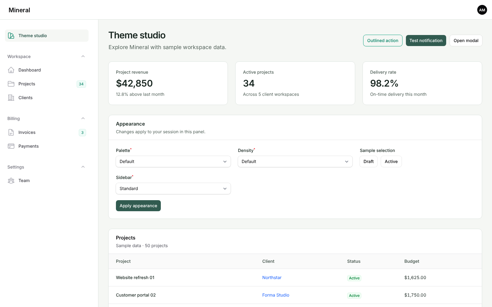
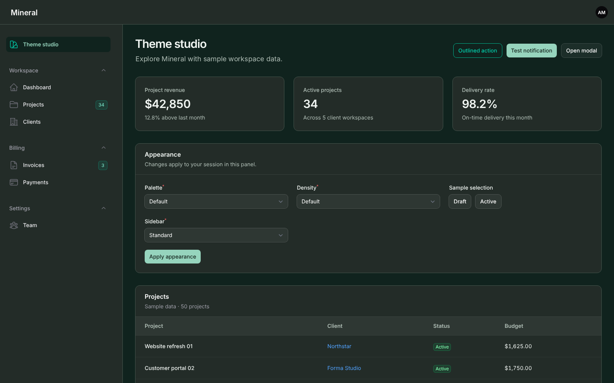

# Mineral for Filament

A calm, readable theme for Filament 4 and 5 panels. Mineral keeps Filament's own components and adds a quiet palette, comfortable surfaces and clear focus states, in both light and dark mode.





## Features

- Default palette in light and dark mode, with text, muted and accent colors checked for contrast
- Compiled CSS overlay on top of Filament's stylesheet: no npm build in your application
- Density setting (compact, default, comfortable) and standard sidebar
- Visible keyboard focus on buttons, tabs, pagination and form fields
- No overrides of Filament's Blade views

## Requirements

- PHP 8.2 or newer
- Laravel 12
- Filament 4 or 5
- A modern browser with CSS `:has()` support (Safari 16.4+, Chrome 111+, Firefox 121+)

## Installation

```bash
composer require serhii-antoniuk/filament-mineral-theme
php artisan filament:assets
```

Register the plugin in your panel provider:

```php
use SerhiiAntoniuk\Mineral\MineralThemePlugin;

public function panel(Panel $panel): Panel
{
    return $panel
        // ...
        ->plugin(MineralThemePlugin::make());
}
```

Keep Filament's own stylesheet enabled: Mineral is an overlay, not a replacement.

## Configuration

Publish the config file to change the defaults:

```bash
php artisan vendor:publish --tag=mineral-theme-config
```

Options set fluently on `MineralThemePlugin::make()` take priority over the config file.

## Development

```bash
composer install
npm ci
npm run build
npm run contrast
composer test
```

## License

MIT. Questions and bug reports: [GitHub issues](https://github.com/sergfront/filament-mineral-theme/issues) or sergefrontend@gmail.com.
